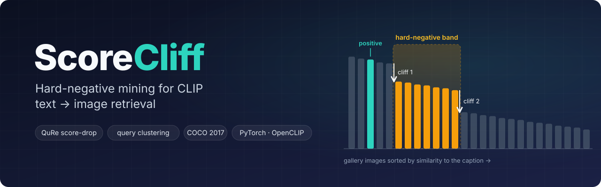

<p align="center">
  
</p>

<p align="center">
  <a href="https://github.com/Lazypilottt/scorecliff/actions/workflows/tests.yml"></a>
  
  
  
  
  <a href="LICENSE"></a>
</p>

<p align="center">
  <a href="#how-it-works">How it works</a> ·
  <a href="#quick-start">Quick start</a> ·
  <a href="#results">Results</a> ·
  <a href="#whats-new-in-v2">What's new in v2</a> ·
  <a href="#project-layout">Layout</a>
</p>

---

**ScoreCliff** fine-tunes CLIP for **text → image retrieval** and studies one question: *which negatives should the model learn from?*

It compares three strategies under one shared pipeline (same model, data, loss and evaluation):

| Miner | Idea |
|---|---|
| 🎲 **Random** | Any image other than the caption's own. The baseline. |
| 🧗 **QuRe score-drop** | Rank the gallery for each caption and find the two steepest score drops ("cliffs") below the correct image. Sample negatives from the band between them: hard, but past the point where near-duplicates and false negatives live. |
| 🧩 **Query clustering** (ICT-Q style) | Cluster the caption embeddings. The images of *other* captions in the same cluster become negatives. Supports k-means, MiniBatch k-means, agglomerative, spectral and HDBSCAN. |

## How it works


For a caption *t* with positive image *v⁺* at rank *r*:

1. Score every gallery image with the current model, `s = cos(t, v)`, and sort in descending order.
2. Compute the successive drops `Δⱼ = s₍ⱼ₎ − s₍ⱼ₊₁₎`, considering only ranks **below** the positive (`j ≥ r + 1`).
3. Take the two largest drops, `j₁ < j₂`. The **hard-negative band** is ranks `j₁+1 … j₂`.
4. Sample *k* negatives from the band. If there aren't two eligible drops, fall back to images ranked below the positive. The fallback rate is logged.

Mining runs on the GPU in chunks, and the gallery is re-mined every epoch after a random-negative warm-up.

**Training objectives:**
- `--loss infonce` (default) is CLIP's symmetric InfoNCE with the mined images appended to the in-batch gallery. Columns that show the *same image* as the positive are masked out, so duplicate captions are never treated as negatives.
- `--loss pairwise` is QuRe's Bradley–Terry objective, `−log σ(τ·(s⁺ − s⁻))`.

Both scale scores by CLIP's learned temperature τ, capped at 100.

<br clear="right">

## Quick start

```bash
git clone https://github.com/Lazypilottt/scorecliff.git && cd scorecliff
pip install -e ".[dev]"                     # torch, open_clip, scikit-learn, ...

# 1. caption tables from a COCO 2017 folder (train2017/, val2017/, annotations/)
scorecliff prepare --coco-root /path/to/coco2017 --out data

# 2. zero-shot baseline on the 5K val2017 gallery
scorecliff evaluate --csv data/val2017.csv --out runs/zero-shot/eval_5k

# 3. fine-tune on 1% of train2017 with QuRe negatives, then evaluate on 5K and 1K
scorecliff train --miner qure --seed 0 --out runs/qure_s0 \
    --eval 5k=data/val2017.csv 1k=data/val2017.csv:1000

# 4. same budget with random negatives, then test whether the difference is real
scorecliff train --miner random --seed 0 --out runs/random_s0 --eval 5k=data/val2017.csv
scorecliff compare runs/qure_s0/eval_5k/ranks.npz runs/random_s0/eval_5k/ranks.npz

# 5. mean ± std over seeds
scorecliff summarize "runs/*/eval_5k/metrics.json" --markdown
```

COCO can be fetched with `kagglehub.dataset_download("awsaf49/coco-2017-dataset")` (~25 GB).

### On Kaggle / Colab

[`notebooks/run_experiments.ipynb`](notebooks/run_experiments.ipynb) runs the whole study on one GPU:
- the zero-shot baseline
- random, QuRe and cluster fine-tuning over 3 seeds
- mean ± std result tables and significance tests
- mining diagnostics and side-by-side retrieval examples

Finished runs are skipped, so the notebook survives session restarts.

### Useful flags

| Flag | Default | Notes |
|---|---|---|
| `--miner` | `qure` | `random`, `qure`, `cluster` |
| `--cluster-algo` / `--n-clusters` | `kmeans` / 40 | `kmeans`, `minibatch`, `agglomerative`, `spectral`, `hdbscan` |
| `--qure-window` | off | Search for cliffs only within the first *N* ranks below the positive |
| `--loss` | `infonce` | `infonce` or `pairwise` |
| `--num-negatives` | 1 | Mined negatives per caption |
| `--warmup-epochs` / `--mine-every` | 1 / 1 | Random-negative warm-up, then the re-mining interval |
| `--caption-frac` / `--num-images` | 0.01 | Training subset: a fraction of captions, or a number of images |
| `--freeze-text` | on | Freezes the whole text tower; caption embeddings are then cached once |
| `--model` | `ViT-B-32-quickgelu` | Any OpenCLIP model name with `--pretrained` |

## Results

### v2 (this pipeline)

The v2 runs have not been done yet. Run `notebooks/run_experiments.ipynb`, then paste in the output of `scorecliff summarize ... --markdown`. Planned protocol:
- **Train:** 1% of COCO train2017 (5,917 captions / 5,814 images, subset seed 501), 5 epochs, seeds 0–2
- **Test:** COCO val2017, with a 5K gallery (25,014 queries) and a 1K gallery
- **Reported:** text → image and image → text R@1/5/10, MRR and median rank, with paired bootstrap p-values against random negatives and zero-shot CLIP

### v1 (original notebooks, archived)

These numbers come from the original notebooks in [`notebooks/v1/`](notebooks/v1), each run once. The issues listed under [What's new in v2](#whats-new-in-v2) affect them, so treat them as preliminary.

<details>
<summary><b>QuRe vs. random</b>: 1% train, 25% of val2017 captions (6,253 queries / 3,789 images)</summary>

| Text → image | QuRe | Random | Δ |
|:--|--:|--:|--:|
| MRR | **42.64** | 41.69 | +0.95 |
| R@1 | **30.75** | 29.86 | +0.90 |
| R@2 | **41.69** | 40.11 | +1.58 |
| R@5 | **55.49** | 54.45 | +1.04 |
| R@10 | **66.29** | 65.86 | +0.43 |

QuRe is ahead at every cutoff, but this is a single seed with no zero-shot reference.
</details>

<details>
<summary><b>Query clustering</b>: 5,000 train images, 1,000-image held-out gallery</summary>

| Clustering | R@1 | R@5 | R@10 | MedR |
|:--|--:|--:|--:|--:|
| MiniBatch k-means (k=40, batch 32) | **14.0** | **37.6** | **54.1** | **9** |
| Agglomerative (Ward, k=40) | 11.2 | 32.4 | 47.5 | 12 |
| Spherical k-means (k=40) | 9.7 | 29.5 | 42.8 | 14 |
| Spectral (k≈70) | 9.5 | 29.3 | 44.0 | 13 |
| HDBSCAN | 8.9 | 27.2 | 39.5 | 16 |

These runs used a softmax temperature of 1.0, which flattens the loss. That is the most likely reason they sit far below zero-shot CLIP. v2 fixes it.
</details>

## What's new in v2

| v1 issue | v2 fix |
|---|---|
| No zero-shot baseline | `scorecliff evaluate` without `--checkpoint` evaluates pretrained CLIP |
| ICT-Q loss used temperature 1.0 (near-flat softmax) | All losses use CLIP's `logit_scale`, capped at 100 |
| QuRe training loss used raw cosine differences (σ ≈ 0.5, tiny gradients) | Pairwise loss is scaled by τ; InfoNCE is the default |
| QuRe searched for drops over the whole ranking; empty bands fell back to the *easiest* image | Drops are searched only below the positive; the fallback samples below the positive and its rate is logged |
| QuRe mining took ~20 min per epoch (Python `list.index` loops) | Vectorised GPU mining takes seconds |
| OpenAI weights loaded without QuickGELU | `ViT-B-32-quickgelu` by default |
| ICT-Q test split could overlap training images | Train on train2017 and test on val2017, disjoint by construction |
| ICT-Q negatives were captions, used only in the image → text term | Cluster miner yields negative *images* for text → image training |
| HDBSCAN noise points formed one giant "cluster"; its loss log divided by cumulative steps | Noise falls back to random negatives; losses are per-epoch means |
| Same-image captions in a batch treated as negatives | Masked in the InfoNCE loss |
| Only the text transformer blocks were frozen | `--freeze-text` freezes the whole text tower |
| "Precision@k" reported, equal to Recall@k | R@k, MRR, MedR and MeanR, in both directions |
| Single unseeded run | Seeded runs, `summarize` (mean ± std) and `compare` (paired bootstrap) |
| Seven copy-pasted notebooks, 52 MB of outputs | One tested package, a CLI and one runner notebook |

## Project layout

```
scorecliff/
├── scorecliff/
│   ├── data.py       COCO caption tables, subsets, datasets
│   ├── model.py      OpenCLIP loading, tower freezing, checkpoints
│   ├── miners.py     random, QuRe score-drop and cluster miners
│   ├── losses.py     InfoNCE with hard negatives, pairwise Bradley–Terry
│   ├── metrics.py    R@k / MRR / MedR, paired bootstrap
│   ├── engine.py     encoding, training loop, evaluation
│   └── cli.py        prepare · train · evaluate · compare · summarize
├── tests/            unit tests + CPU end-to-end smoke test
├── notebooks/
│   ├── run_experiments.ipynb   v2 experiment runner
│   └── v1/                     original notebooks (archived, outputs kept)
└── assets/banner.svg
```

## Testing

```bash
pytest -q
```

The suite runs on CPU in a few seconds. It checks:
- the QuRe band and fallback edge cases
- every clustering algorithm
- both losses against reference implementations
- the metrics and the bootstrap
- an end-to-end train → evaluate run with a tiny model

CI runs it on every push.

## Roadmap

- [ ] Run the v2 study and publish the result tables
- [ ] Ablations: `--qure-window`, number of negatives, unfreezing the text tower
- [ ] Larger training budgets (5%, 25%) and Flickr30K transfer
- [ ] Mixed miners (QuRe band ∪ cluster neighbours)

## References

- Radford et al., *Learning Transferable Visual Models From Natural Language Supervision*, ICML 2021
- Kwon et al., *QuRe: Query-Relevant Retrieval through Hard Negative Sampling in Composed Image Retrieval*, ICML 2025
- Lin et al., *Microsoft COCO: Common Objects in Context*, ECCV 2014
- Ilharco et al., *OpenCLIP*, 2021 — <https://github.com/mlfoundations/open_clip>
- Campello et al., *Density-Based Clustering Based on Hierarchical Density Estimates* (HDBSCAN), PAKDD 2013

## Citation

```bibtex
@software{yadav2026scorecliff,
  author = {Yadav, Aditya},
  title  = {ScoreCliff: Hard-Negative Mining for CLIP Text-to-Image Retrieval},
  year   = {2026},
  url    = {https://github.com/Lazypilottt/scorecliff}
}
```

## License

[MIT](LICENSE) © Aditya Yadav
